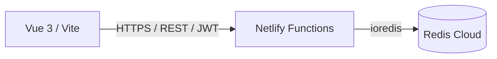

# Jazz Collection

[](https://vuejs.org/)
[](https://nodejs.org/)
[](https://redis.io/cloud/)
[](https://www.netlify.com/)
[](https://jwt.io/)

**Aplicación desplegada:** [https://collection-redis.netlify.app](https://collection-redis.netlify.app)

## Overview

Explore a curated collection of jazz albums, artists and subgenres through a Vue.js interface backed by a serverless REST API. This iteration replaces MongoDB with Redis Cloud while preserving the existing application and authentication flow.

- Relational navigation between albums, artists and subgenres using application-level references.
- Full CRUD with administrator-only write access.
- JWT authentication, bcrypt password hashing and protected routes.
- Redis-backed JSON records, reusable connections and incremental identifiers.
- 24 initial catalog records with local WebP images.

## Architecture



| Layer | Technology |
|---|---|
| Frontend | Vue 3, Vue Router, Vite |
| Backend | Node.js, Netlify Functions |
| Persistence | Redis Cloud, ioredis |
| Authentication | JSON Web Tokens, bcryptjs |
| Hosting | Netlify |

## Getting started

**Prerequisites:** Node.js 22.16+ (within Node 22) or Node.js 24 LTS, npm and a [Redis Cloud](https://cloud.redis.io/) database.

```powershell
npm install
Copy-Item .env.example .env
node -e "console.log(require('crypto').randomBytes(48).toString('hex'))"
```

Configure `.env` with your own credentials:

```dotenv
REDIS_HOST=
REDIS_PORT=
REDIS_PSW=
REDIS_USERNAME=default
REDIS_TLS=false
JWT_SECRET=
```

Set `REDIS_TLS` according to your endpoint configuration. Alternatively, use `REDIS_URL` (`rediss://` for TLS) instead of the individual connection settings. Use a random JWT secret of at least 32 characters. Never commit `.env`.

```bash
npm run seed
npm run dev
```

Visit [localhost:8888](http://localhost:8888). Register an account, then optionally promote it to administrator:

```bash
npm run admin -- admin@example.com
```

Replace the email with the registered account and sign in again. The seed preserves existing records and does not decrease ID counters.

## REST API

| Method | Endpoint | Access | Success |
|---|---|---|---:|
| POST | `/api/auth/register` | Public | 201 |
| POST | `/api/auth/login` | Public | 200 |
| GET | `/api/auth/me` | Authenticated | 200 |
| GET | `/api/{resource}` | Authenticated | 200 |
| GET | `/api/{resource}/{id}` | Authenticated | 200 |
| POST | `/api/{resource}` | Admin | 201 |
| PUT | `/api/{resource}/{id}` | Admin | 200 |
| DELETE | `/api/{resource}/{id}` | Admin | 204 |

Resources: `albums`, `artists`, `subgenres`. Protected requests require `Authorization: Bearer <token>`. Tokens use HS256 and expire after two hours. The API checks the current user role in Redis. Missing or invalid sessions return `401`; insufficient permissions return `403`; duplicate emails and referenced-entity deletions return `409`.

## Data model

| Resource | Redis key pattern | Initial records |
|---|---|---:|
| Albums | `jazz:albums:<id>` | 12 |
| Artists | `jazz:artists:<id>` | 6 |
| Subgenres | `jazz:subgenres:<id>` | 6 |
| Users | `jazz:users:<email>` | On registration |

Records are serialized as JSON strings. Albums reference artists and subgenres by ID. `INCR` generates identifiers, `SCAN` and `MGET` retrieve collections, and `SET NX` prevents duplicate key insertion.

## Project structure

```text
jazz-collection-redis/
├── data/                 # Seed datasets
├── netlify/
│   ├── functions/api.js  # REST entry point
│   └── lib/              # Redis connection and store
├── public/images/        # Catalog artwork
├── scripts/              # Seed and role management
├── src/                  # Vue views and authentication
├── tests/                # Data and store tests
├── .env.example
├── netlify.toml
└── package.json
```

## Deployment & verification

Import the repository into [Netlify](https://app.netlify.com/), configure the Redis and JWT environment variables for Functions, and deploy. `netlify.toml` defines the build, `dist` publish directory, functions directory and routing. Seed the target Redis database before use.

```bash
npm test
npm run build
```

Tests cover seed data, references, images and a simulated Redis store. Live integration, production deployment and build verification remain pending. Reference validation and writes are separate operations, not atomic transactions. The dependency lockfile should be generated and committed after installation.

---

Developed by [Andrea Carrillo Oporto](https://github.com/AndreaCarrilloOp) as part of an academic distributed systems project at Universidad Nacional, Costa Rica.
